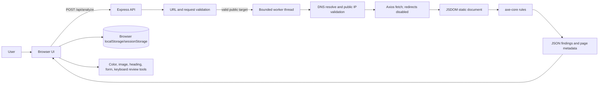
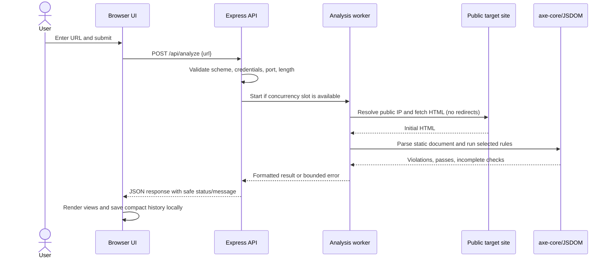
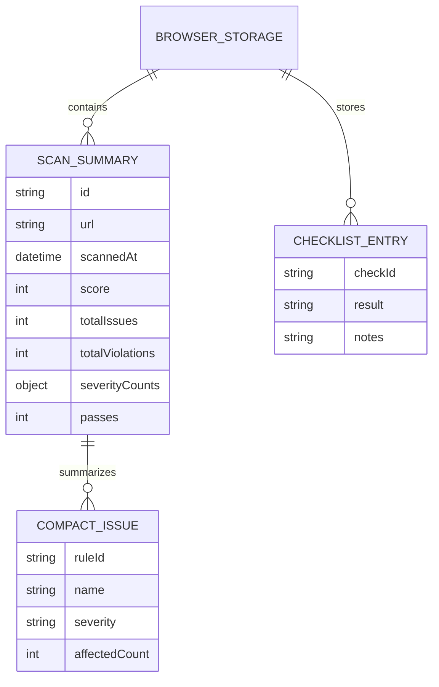

# DesignLens Technical and Academic Report

**Project:** DesignLens — Static Website Accessibility Analyzer

**Repository revision assessed:** Initial commit `4db5519` with the stabilization changes described in this report

**Report date:** 25 November 2026

**Academic context:** Third-year engineering mini-project

> The supplied assignment brief refers to “S Campus Care,” but the linked repository implements DesignLens. This report documents DesignLens as implemented. No campus-care functionality, AI model, database server, or predictive model exists in this codebase.

## Abstract

DesignLens is a small web application for reviewing accessibility barriers in public web pages. A user submits a URL through a browser interface. An Express API validates the request, and an isolated worker fetches the page's initial HTML, parses it with JSDOM, and runs selected axe-core WCAG 2.0, 2.1, and 2.2 A/AA rules. The browser displays rule violations, severity counts, example elements, and suggested remediation. JSON/CSV exports and rule-level scan comparisons help users preserve and review findings. Additional browser-side tools help review color pairs, image alternatives, headings, forms, keyboard tasks, and prior scans.

The project demonstrates a full-stack request pipeline and practical use of an established accessibility rule engine. It is a screening and learning aid, not a conformance certificate. Because the analysis uses a DOM implementation without layout or rendering, it does not reliably assess visual contrast or fully rendered client-side applications. The application includes no AI/ML component; its classification and severity values come from axe-core rules and impact labels.

## 1. Introduction and problem statement

Web authors need a repeatable way to find common accessibility issues and understand how to repair them. Manual review is essential but can be time-consuming, while a bare list of rule identifiers can be difficult for novice developers to act on.

**Problem statement:** Provide a local, easy-to-demonstrate tool that accepts a public web address, runs a bounded automated accessibility scan against its static HTML, and presents findings with contextual examples and supplementary manual review tools.

This application does not address campus complaints or student support. That different problem statement would require a different product and data model; it cannot be claimed from this repository.

## 2. Existing and proposed system

The existing project is already the proposed DesignLens application: a single-page browser UI and one Express analysis API. It combines axe-core output with focused views for issues, fixes, contrast pairs, alt text, headings, form issues, a manual keyboard checklist, browser-local scan history, comparison, and lessons.

The stabilization work in this branch preserves this architecture and strengthens its URL-fetching boundary, resource limits, error handling, dependency reproducibility, and verification. It does not add a new product domain or fabricate an AI capability.

## 3. Objectives, scope, and applications

### Objectives

1. Accept a user-entered public HTTP/HTTPS website URL.
2. Fetch its initial HTML safely and run axe-core rules.
3. Explain violations and show bounded snippets of affected elements.
4. Offer supplementary manual and focused accessibility review tools.
5. Keep the project easy to run and demonstrate locally.

### Scope and limitations

- One fetched document per scan; no crawl or authenticated session.
- Initial HTML only; JavaScript in the target page is not executed.
- No subresources are loaded by the analyzer.
- No database, server-side accounts, notifications, or shared history.
- History and manual checklist state are browser-local.
- axe-core output is automated evidence, not proof of WCAG conformance.
- JSDOM does not calculate real browser layout; scanned-page contrast is not reliably assessed.
- Browser-side contrast calculator works for solid foreground/background color pairs supplied by the user.

## 4. Technology stack and rationale

| Layer | Technology | Role |
|---|---|---|
| UI | HTML5, CSS, vanilla JavaScript | Single-page navigation and results views |
| UI libraries | Bootstrap, Bootstrap Icons, Chart.js via jsDelivr | Layout, icons, and severity chart |
| Server | Node.js 18+, Express | Static files and JSON API |
| HTTP fetch | Axios | Time-bounded initial document fetch |
| DOM | JSDOM | Parse static HTML without a full browser |
| Accessibility rules | axe-core | Deterministic rule checks and issue metadata |
| SSRF defense | DNS lookup, `ipaddr.js` | Reject non-public address ranges and pin vetted answers |
| Availability | Node worker threads | Enforce analysis deadline and concurrency limit |
| Security | Helmet, express-rate-limit | Response headers and per-IP request limit |
| Persistence | localStorage/sessionStorage | Local scan summaries and checklist/review state |
| Tests | Node built-in test runner | Unit and HTTP API tests |

There is no AI service or ML package. axe-core is a rule-based accessibility testing engine; severity derives from its rule impact values. It should not be presented as a trained classifier.

## 5. System architecture

### Layer boundaries

- **Presentation:** `public/index.html`, `public/css/style.css`, `public/js/app.js`.
- **API/application:** `server.js` validates requests, applies rate limits, maps errors, and serves static files.
- **Analysis:** `backend/analyzer.js` performs vetted network retrieval, DOM parsing, axe execution, formatting, and resource bounding.
- **Persistence:** local browser storage only. No server-side data-access layer exists.
- **External integrations:** jsDelivr for front-end libraries and the user-selected website for scan input. There is no AI provider.

## 6. Data flow and API

### Scan data flow

### API contract

#### `GET /api/health`

Returns HTTP 200 and `{ "status": "ok" }`.

#### `POST /api/analyze`

Content type: `application/json`. Body: `{ "url": "https://example.com" }`.

Validation requires an HTTP or HTTPS URL, no embedded credentials, a maximum 2,048-character URL, and standard web ports. Literal and DNS-resolved target addresses must be public unicast. All returned DNS answers are checked; a mixed public/private answer is rejected. The vetted address is passed to the socket, and redirects are rejected.

On success the response contains `url`, `scannedAt`, `durationMs`, `totalIssues`, `totalViolations`, `severityCounts`, `categories`, `issues`, `passes`, `incomplete`, `images`, `headings`, and `formCount`. `severityCounts` and `totalIssues` count affected nodes; `totalViolations` counts failing rules. Each issue includes its axe identifier, description, tags, impact, a capped set of affected element snippets, total affected count, and a suggestion.

Error statuses include 400 for invalid request/URL, 403 for non-public targets, 422 for redirects or non-HTML responses, 429 for rate limiting, 502 for connection failures, 503 for busy workers, 504 for timeout, and 500 for unexpected errors. Unexpected error messages stay in server logs; the response includes a correlation request ID.

## 7. Database design and browser-side data model

There is no relational database. The UI stores scan summaries and checklist state in browser storage, scoped to one browser profile.

The history is compact rather than a full report archive. “View” currently presents a summary alert; full scan results are not restored after page reload. Data can be cleared by the browser user and is not synchronized across devices.

## 8. Accessibility and analysis methodology

1. Parse the user URL and enforce transport, host, and port constraints.
2. Resolve all DNS answers and reject any that fall outside public unicast ranges.
3. Pin the selected vetted address for the socket request; disable redirects and proxies.
4. Fetch up to 5 MiB with a 12-second request timeout; require an HTML content type.
5. Parse the static HTML in JSDOM with scanned scripts and subresources disabled.
6. Inject the trusted local axe-core bundle into the JSDOM realm.
7. Run the configured WCAG 2.0/2.1/2.2 A/AA and best-practice tags supported by the installed axe-core release.
8. Format violation metadata and cap serialized affected-node snippets.
9. Terminate analysis after 20 seconds and reject new work when two worker slots are occupied.

axe-core reports violations, passes, and incomplete checks. An incomplete check means human review is needed. The current UI computes a project-specific score as `max(0, 100 − 10×critical − 5×serious − 2×moderate − minor)`, with inputs counting affected elements. This is not a WCAG score and should not be interpreted as a conformance percentage.

**AI workflow:** none is implemented. There is no meaningful model training data or model evaluation in this project. A future proposal could use semantic matching to group repeated findings, but it would need a labeled evaluation set and must not replace deterministic rule checks. That feature is not included here.

## 9. Module descriptions

| Module | Implemented behavior |
|---|---|
| Scanner dashboard | Score indicator, counts, chart, scan metadata |
| Issue explorer | Search, severity filter, sorting, issue details, reviewed state |
| Fix assistant | Rule-specific guidance for selected common rules |
| Contrast checker | Pairwise solid-color WCAG threshold calculator |
| Alt-text analyzer | Summarizes image `alt` attribute presence/value from fetched HTML |
| Heading analyzer | Shows static H1–H6 outline and possible skipped levels |
| Form checker | Reuses selected axe form/name violations and form count |
| Keyboard checklist | Manually entered checks stored in browser storage |
| More Checks | Static summaries for links, same-page fragments, tables, page basics, alt-text wording hints, media caption tracks, and control names; saved manual reviews for form errors, focus, zoom/reflow, and PDFs |
| Scan history/comparison | Compact browser-local summaries; comparison reports new, resolved, and persistent rule findings plus affected-element count changes |
| Report export | Full scan JSON and spreadsheet-safe CSV downloads; CSV includes finding samples and scan summary metadata |
| Learning hub | Static accessibility lessons |
| API/analyzer | Validated public URL fetch, static DOM analysis, error mapping, exact-origin CORS for a separately hosted Pages frontend |

## 10. Audit findings and repairs

### Initial findings

The initial implementation used hostname prefix checks, followed redirects, and enabled target scripts and subresources in JSDOM. This created SSRF and resource-exhaustion/code-execution risks. The API returned raw error details. Analysis had no hard deadline. There was no package lock or test suite. The project brief and repository product did not match.

### Repairs in this branch

- Replaced hostname string filtering with public address classification, DNS validation, and pinned resolution.
- Disabled redirects, proxy use, target scripts, and target subresource loading.
- Moved scans into worker threads with a 20-second timeout and two-worker cap.
- Added API payload validation, standard-port checks, request IDs, safe errors, health endpoint, API 404 behavior, CSP, and JSON parse/size errors.
- Removed unused permissive CORS configuration for the same-origin app.
- Added lockfile, corrected Node engine floor to 18, added test script, and overrode vulnerable `minimatch` with a fixed compatible release.
- Fixed invalid contrast input feedback and hid stale scan output when a new scan begins.
- Added WCAG 2.2 A/AA axe tags, JSON/CSV downloads, and issue-level comparison of saved scans.
- Added focused static summaries for links, tables, page setup, alt-text wording, media tracks, and interactive control names, plus browser-local guided reviews for form errors, keyboard focus, zoom/reflow, and PDF accessibility.
- Added a GitHub Pages workflow, relative asset paths for project sites, configurable API base URL, and allowlisted API CORS for the split Pages/Render deployment.
- Rewrote setup and limitation documentation to reflect the real repository.

### Remaining concerns

- Worker threads share the parent process and are not a full memory/OS sandbox.
- CDN libraries are runtime dependencies of the UI; an outage can impair charting or styling.
- No automated browser/UI journey tests, database, auth, or server-side history. A Pages workflow exists but has not yet completed an external deployment.
- DNS pinning and public address filtering reduce SSRF exposure; deployment should also enforce egress controls at the network layer.
- Full report restoration and selector-level comparison remain incomplete; the current comparison matches findings by axe rule ID.

## 11. Testing methodology and actual results

Run `npm ci`, then `npm test`. Tests use the built-in Node test runner and start temporary local HTTP servers for API behavior. The analyzer security test confirms that axe scans do not request a page-provided script. API tests cover health, invalid URL inputs, private targets, known/unexpected error mapping, CSP, and API 404 behavior. The scan response reports the configured WCAG 2.0, 2.1, 2.2 A/AA, and axe best-practice scope; this is automated partial coverage, not a conformance claim.

### Executed evidence

| Check | Result | Evidence |
|---|---|---|
| `npm test` | **Passed: 12, failed: 0, skipped: 0** | Executed on Node v24.19.0; includes WCAG 2.2 tag configuration, additional page-data and CORS allowlist checks, address-range tests, no-script/no-subresource test, and API integration tests |
| `npm audit` | **0 vulnerabilities** | Executed after pin override for transitive `minimatch` |
| Live `GET /api/health` | **Passed, HTTP 200** | Running local Express service returned `{status:"ok"}` |
| Live private URL request | **Passed rejection, HTTP 403** | `http://127.0.0.1` rejected before analyzer invocation |
| Live public scan | **Passed, HTTP 200** | `https://example.com` fetched and analyzed; response contained results in approximately 2.7 seconds in the final smoke run |
| Manual browser feature check | **Passed** | Downloaded and inspected JSON/CSV reports; compared saved scans and confirmed new, resolved, persistent, and affected-count results |
| Frontend browser interaction/E2E | **Not run** | No browser automation dependency or test harness exists in the repository; the new hosting workflow and guided check panels were not visually verified |
| External credential-dependent integrations | **Not applicable** | No AI provider, database, or credentialed service integration exists |

Observed duration is a single smoke-test result, not a benchmark or performance guarantee. axe rules are not independently validated against a labeled ground-truth corpus.

## 12. Setup and demonstration instructions

1. Install Node.js 18+.
2. Run `npm ci` from the repository root.
3. Run `npm start` and open `http://localhost:3000`.
4. Scan `https://example.com` to demonstrate a public URL workflow.
5. Open the Issue Explorer and Fix Assistant to explain rule IDs, impact, affected nodes, and suggested remediation.
6. Open More Checks to review link/table/page summaries, alt-text hints, media, and control names. Mark the keyboard, form-error, and reflow steps manually.
7. Optionally choose a PDF and open it locally for the guided PDF checklist; the file is not uploaded or automatically analyzed.
8. Demonstrate the separate color-pair tool and explain why it does not claim to measure the target page's rendered contrast.
9. Show history and checklist state as browser-local data; download JSON/CSV and compare two saved scans.

## 13. Results, advantages, and limitations

The implemented system successfully provides a repeatable static scan path and several complementary teaching utilities. Its key engineering work includes input validation, network boundary controls, timeout/concurrency behavior, result formatting, and explicit differentiation between automated checks and manual review.

Its principal limitations are static-document coverage, no layout engine, no persistent user database, no crawl or login support, and no AI/ML. The score is project-defined. A clean result means only that this configured axe scan reported no detected violations in the analyzed document; it is not a certification.

## 14. Academic value and feature prioritization

| Candidate | Fit for this repository | Effort | Academic value |
|---|---|---:|---|
| Safer bounded URL analysis | Implemented | Medium | High: DNS/IP security, worker isolation, API behavior |
| Browser scan-history restore | Good | Medium | Medium: persistence and data lifecycle |
| Selector-level scan diff | Good | Medium | Medium: finer matching and explainable comparisons |
| Browser-rendered analysis | Strong but major architecture change | High | High: browser automation, resource sandboxing, rendered states |
| User accounts/shared projects | Optional | High | Medium: auth, database, authorization, privacy |
| AI classification or recommendations | Weak without labeled data | High | Low until evaluation data and baseline exist |
| Campus complaint routing/chatbot | Different product domain | Very high | Out of scope for this repository |

Best next project-specific improvements are a browser-engine scan mode with stronger isolation, full local report restoration, selector-level comparison, a browser-based end-to-end test, and deployment-level egress controls.

## 15. Faculty presentation preparation

### Two-minute introduction

“DesignLens is a web accessibility screening tool. A user submits a public page URL, and our Express API validates the target before a worker fetches its initial HTML. We parse that static document in JSDOM and run axe-core, then return rule violations, impact, affected elements, and suggestions to a browser dashboard. We also provide separate tools for color-pair checks, image alternatives, heading structure, forms, and a manually completed keyboard checklist.

The engineering focus is the end-to-end pipeline and its safety boundaries. The analyzer rejects non-public network addresses, does not follow redirects, does not execute the target's scripts or load its resources, caps response size and time, and limits concurrent workers. We have unit and API tests for these behaviors and a live scan smoke test.

We are careful about limitations: this version analyzes only the initial HTML. JSDOM does not render layout, so we do not claim reliable scanned-page contrast analysis. It has no AI model or database, and axe output is not a compliance certificate. Our goal is an explainable first-pass review tool that helps developers find and understand common issues.”

### Five-minute demonstration

1. **0:00–0:30 — Context:** Open the dashboard and state the exact scope: static public HTML accessibility scan.
2. **0:30–1:15 — End-to-end scan:** Submit `https://example.com`; explain browser POST, API validation, worker fetch, JSDOM, and axe output.
3. **1:15–2:00 — Findings:** Show rule-level violation versus affected element counts, severity impact, tags, and help URL.
4. **2:00–2:45 — Remediation:** Open a fix card and relate before/after code to a rule; explain suggestions are guidance for review.
5. **2:45–3:30 — Other diagnostics:** Show image/heading/form summaries and the separate color-pair calculator.
6. **3:30–4:15 — Manual evaluation:** Show the keyboard checklist and distinguish user-entered results from automated axe results.
7. **4:15–5:00 — Engineering and limits:** Show API health/test results, worker timeout and SSRF protections, then honestly describe static HTML/JSDOM limits.

### 30 likely viva questions and answers

1. **What problem does DesignLens solve?** It gives developers a first-pass automated accessibility scan with contextual findings and review utilities.
2. **What is the stack?** Vanilla browser UI, Express/Node.js, Axios, JSDOM, axe-core, and browser storage.
3. **What happens after submitting a URL?** The API validates it, starts bounded analysis, fetches HTML, runs axe on a JSDOM document, formats results, and returns JSON.
4. **What is axe-core?** An open-source accessibility rule engine for web UI checks.
5. **Is axe-core AI?** No. It evaluates deterministic rules; the project has no AI/ML model.
6. **What does JSDOM do?** It parses and models parts of browser DOM APIs in Node; it is not a full rendering browser.
7. **Why use a worker thread?** To keep analysis off the main event loop and terminate work at a deadline.
8. **Does a worker provide complete isolation?** No. It shares the process and machine; stronger deployment isolation and egress controls are still advisable.
9. **How is SSRF reduced?** Restrict schemes/ports, resolve DNS, reject non-public answers, pin the selected public address, reject redirects, and disable subresources.
10. **Why reject redirects?** A public URL could redirect to a private target, bypassing validation.
11. **How is DNS rebinding addressed?** Every DNS answer is checked and the validated answer is passed directly to the socket.
12. **Why block all answers if one is private?** To avoid selecting an alternate private answer from a mixed DNS response.
13. **What is the request size limit?** 10 KiB for JSON input and 5 MiB for fetched HTML.
14. **What are the time limits?** 12 seconds for fetch and 20 seconds for full worker analysis.
15. **Why cap concurrency?** To bound resource consumption from simultaneous scans.
16. **What does “incomplete” mean?** axe could not determine the result confidently, so a person should review it.
17. **Does zero violations mean WCAG compliance?** No. It means these configured automated rules found no violation in the fetched document.
18. **Can this analyze a React SPA?** Only the initial response HTML; it does not execute scripts or wait for rendered content.
19. **Can it check contrast of a scanned page?** Not reliably, because JSDOM lacks browser layout/rendering. The separate tool checks user-entered solid colors.
20. **Where is scan history stored?** In browser localStorage, not in a database.
21. **What data is stored for history?** Compact scan summaries and issue identifiers/counts; full scan reports are not persisted.
22. **What is the score formula?** A project-specific weighted penalty based on affected-element severity counts, clamped to 0–100.
23. **Is that score standardized?** No, it is explicitly a project indicator, not a WCAG score.
24. **How are errors handled?** Known failure classes map to statuses and safe messages; unexpected errors are logged with request ID and hidden behind a generic response.
25. **What tests were executed?** Twelve built-in Node unit/API tests, dependency audit, and live health/private-target/public-scan checks.
26. **Were frontend E2E tests run?** No; there is no browser automation harness in the repo.
27. **What security headers are used?** Helmet with CSP and other defaults. Cross-origin API calls are allowed only from configured frontend origins.
28. **Why pin dependencies with a lockfile?** To make installs repeatable and preserve the audited dependency tree.
29. **What is the biggest remaining technical limitation?** Static HTML analysis without a real browser rendering engine.
30. **What would you build next?** A carefully sandboxed browser-based scan mode, then full report restore and finding-level diffs.

### Difficult questions and honest responses

- **“Why claim WCAG 2.2 AA if incomplete?”** The configured axe rule tags now include WCAG 2.2 A/AA, but the scan is partial and cannot establish conformance. The UI and report must keep that qualification explicit.
- **“Why isn’t AI included?”** No labeled campus/accessibility dataset or evaluated model exists in this repository. Calling deterministic rules AI would be inaccurate and add risk without measured benefit.
- **“Can a worker prevent memory exhaustion?”** It provides a deadline and separate event loop, not a hard memory boundary. OS/process/container limits would be needed for stronger isolation.
- **“Why not scan any URL and follow redirects?”** Redirects and internal address pivots increase SSRF risk. The current user must submit the final public URL.
- **“How do you know findings are accurate?”** Results are axe-core rule findings on the fetched static document; there is no ground-truth corpus or measured precision/recall claim. Human review remains required.

## 16. Evaluation and readiness

| Dimension | Assessment | Reason |
|---|---|---|
| Functionality | 8/10 | Added WCAG 2.2 checks, exports, rule-level comparison, and focused accessibility review tools; static-scan scope and full history restore remain |
| Architecture | 6/10 | Understandable small stack with improved analysis boundary; frontend remains monolithic |
| AI implementation | 0/10 (not present) | No AI feature is claimed |
| Data design | 4/10 | Simple browser-local summaries, no relational data layer |
| Security | 6/10 for student demo | Stronger URL controls and time bounds; worker is not a full sandbox |
| User experience | 6/10 | Broad single-page tools; browser-level accessibility verification not run |
| Testing | 6/10 | Focused tests and smoke checks; no browser E2E, DB, or model tests |
| Academic value | 7/10 | Demonstrates APIs, async processing, security, DOM analysis, and honest limits |
| Demonstration readiness | 7/10 | Local setup and happy-path scan verified; browser automation remains unverified |

### Five highest-priority remaining improvements

1. Add a browser-engine scanning mode with strict process/container and network isolation.
2. Add a browser E2E workflow and accessibility checks for DesignLens itself.
3. Persist full scan reports locally with safe size/retention limits and make history “View” restore them.
4. Add WCAG version filtering and export saved historical reports.
5. Add deployment egress restrictions and production request logging/monitoring.

## References

1. W3C, [Web Content Accessibility Guidelines (WCAG) 2.2](https://www.w3.org/TR/WCAG22/).
2. Deque Systems, [axe-core accessibility engine](https://github.com/dequelabs/axe-core). Its documentation describes the rule engine and notes JSDOM's color-contrast limitation.
3. jsdom, [Project README](https://github.com/jsdom/jsdom). The project documents that it does not implement visual layout/rendering.
4. Express, [Express 4.x API reference](https://expressjs.com/en/4x/api.html).
5. Node.js, [Worker threads documentation](https://nodejs.org/api/worker_threads.html).

No performance benchmark, classifier accuracy, user study, or compliance result is claimed in this report.
